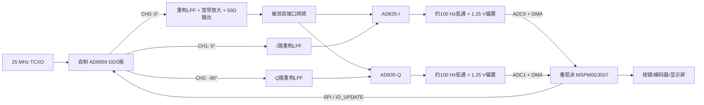

# 2013 E题《简易频率特性测试仪》联网调研与番茄派推荐方案

> 调研日期：2026-07-13
> 目标平台：番茄派 MSPM0G3507（LQFP-48）
> 当前阶段：方案调研，不展开实际固件和原理图设计

## 1. 结论先行

本题最稳妥的技术主线是：

**自制 AD9959 正交扫频源 + 两路 AD835 零中频解调 + 低通/电平平移 + MSPM0G3507 双 ADC + 数字校准与显示。**

选择这条路线的理由：

1. 原题明确要求零中频正交解调，AD835 双乘法器方案与题意完全一致。
2. 公开优秀作品和后续论文已经验证了“正交 DDS + AD835 + 低通 + ADC”可以达到幅度误差 0.5 dB、相位误差 5°的指标。
3. AD9959 有 4 个同步 DDS 通道，可同时提供激励、I 路本振、Q 路本振和备用校准信号；频率、相位、幅度均可独立编程。
4. 仓库已有番茄派控制 AD9959 的实跑驱动，软件起点明显优于改用陌生 DDS。
5. MSPM0G3507 的双 12 位 4 MSPS ADC、DMA、MATHACL 的 SQRT/ATAN2 很适合采集基带 I/Q 并计算幅相，但它不适合直接采样 40 MHz 射频，因此仍需模拟零中频前端。

需要特别说明：原题禁止使用商业 DDS 开发板或成品模块。因此：

- **培训验证阶段**：可以先用现有 AD9959 模块验证控制、扫频和解调原理。
- **按原题正式验收**：必须把 AD9959、时钟、滤波、供电和输出接口做成自制 PCB，并按题目要求在覆铜层加入“2013”字样。现成 AD9959 模块只能作为调试工具，不能装入最终参赛作品。

## 2. 原题指标对方案的约束

原题要求正交扫频源覆盖 1 MHz - 40 MHz，最小步进 100 kHz，正交相位误差不超过 5°，幅度平衡误差不超过 5%，输出不低于 1 Vpp，连续扫频不超过 2 s。发挥部分要求 50 Ω 输入/输出，点频幅度误差不超过 0.5 dB、相位误差不超过 5°，并在 30 s 内完成线性扫频测量。[全国大学生电子设计竞赛原题](https://nuedc.org/problems/2013_E%E9%A2%98_%E7%AE%80%E6%98%93%E9%A2%91%E7%8E%87%E7%89%B9%E6%80%A7%E6%B5%8B%E8%AF%95%E4%BB%AA.pdf)

| 指标 | 对设计的直接影响 |
|---|---|
| 1 MHz - 40 MHz | DDS、重构滤波器、输出放大器、乘法器和 PCB 均需覆盖至少 40 MHz |
| 稳定度 ≤ 10^-4 | 参考时钟需优于 100 ppm，建议使用 10 ppm 或更好的 TCXO |
| 正交误差 ≤ 5° | DDS 通道必须同步更新，I/Q 模拟链路需对称，并做逐频点相位校准 |
| 幅度平衡 ≤ 5% | I/Q 滤波和放大链路需一致，DDS 幅度寄存器用于逐频点修正 |
| 输出 ≥ 1 Vpp | DDS DAC 后必须配置合适的负载、重构滤波和宽带输出放大器 |
| 391 个频点、测量 ≤ 30 s | 平均每点最多约 76.7 ms，低通截止频率不能过低 |
| 幅度误差 ≤ 0.5 dB | 必须做直通校准、ADC 零偏校准和幅度归一化 |
| 相位误差 ≤ 5° | 必须补偿固定电缆延时、PCB 路径差、DDS 与乘法器通道误差 |

## 3. 联网找到的典型解决方案

### 3.1 FPGA + 双 DAC900 + STM32 + AD835

公开的 2013 E题优秀论文摘要采用 FPGA 控制两片高速 DAC900 产生两路正交扫频信号，STM32 负责控制、闭环稳幅、ADC 采样和显示，双 AD835 完成零中频混频。[优秀论文摘要](https://download.eeworld.com.cn/detail/solarelec/603297)

优点：

- 正交波形完全由同一 FPGA 时序产生，控制直接。
- 两片高速 DAC 可获得较高输出采样率。
- 是接近原竞赛时间点的实作路线，技术可信度高。

缺点：

- FPGA、双 DAC、高速并行总线和时钟布局工作量大。
- 两路 DAC 的增益、偏置、时延仍要校准。
- 对当前团队而言会重复建设已有 AD9959 能力。

结论：适合作为原理和高性能备选，不是当前番茄派路线的首选。

### 3.2 AD9854 + AD835 + 低通 + ADC

公开论文给出了成熟的 1 MHz - 40 MHz 实作：AD9854 产生正交 DDS，AD835 与二阶有源低通提取 I/Q，ADS1271 采集，STM32F407 处理；文中报告幅度精度优于 0.5 dB、相位精度优于 5°。[《一种简易数字控制频率特性测试仪的设计》](https://chinaelectrondevices.seu.edu.cn/ch/reader/view_abstract.aspx?file_no=dz14000680&flag=1)

另一篇开放论文同样使用 AD9854、AD835 和 MCU 片上 ADC，并给出了正交乘积法的推导和实物模块。[《面向实践教学的模块化幅频特性测试仪的设计与实现》](https://www.sciengine.com/doi/pdf/2BFAA92719D741198C7D77B537B020F9)

AD9854 本身集成双 12 位正交 DAC、48 位频率寄存器和 14 位相位寄存器，正交相位误差指标适合本题。[AD9854 官方资料](https://www.analog.com/en/products/ad9854.html)

优点：

- 芯片天生输出 I/Q，公开方案最多，理论与硬件均容易对照。
- 12 位 DAC 比 AD9959 的 10 位 DAC 有更高的原始幅度分辨率。

缺点：

- 器件较老、功耗较高、80 引脚封装，PCB 难度不低。
- 团队已有的是 AD9959 驱动和资料，切换 AD9854 会增加学习与采购成本。

结论：成熟可靠的 B 方案；若 AD9959 自制板进展受阻，可退回此路线。

### 3.3 AD9959 + AD835 + MSPM0G3507（推荐）

AD9959 具有 4 个同步 500 MSPS DDS 通道，各通道频率、相位和幅度独立控制，具有匹配的更新延迟、14 位相位偏置和 10 位幅度缩放。[AD9959 官方资料](https://www.analog.com/en/products/ad9959.html)

ADI 还公开了 AD9958/AD9959 评估板原理图、BOM 和 Gerber，可作为自制 PCB 的电源、时钟、去耦和 DAC 输出网络参考，但不能直接把评估板当成参赛成品。[EVAL-AD9959 资料页](https://www.analog.com/en/resources/evaluation-hardware-and-software/evaluation-boards-kits/eval-ad9959.html)

这是本报告基于官方参数、公开 AD9854 实作和仓库现有驱动做出的工程迁移判断；目前没有找到“AD9959 + MSPM0G3507 完整复现 2013 E题”的公开原始作品。因此它是**高把握推荐方案，但仍需分模块实测验证**。

推荐的 AD9959 通道分配：

| 通道 | 相位 | 用途 |
|---|---:|---|
| CH0 | 0° | 经滤波、放大后作为被测网络激励 |
| CH1 | 0° | I 路 AD835 本振 |
| CH2 | -90° | Q 路 AD835 本振，使解调后的 Q 符号为正 |
| CH3 | 可编程 | 校准、监测或后续扩展 |

全部通道用同一个 `IO_UPDATE` 同步换频。按 500 MHz 系统时钟计算，32 位频率字分辨率约 0.116 Hz，14 位相位字分辨率约 0.022°，均远优于题目要求。

### 3.4 AD8302 一芯片幅相检测

AD8302 可直接给出 ±30 dB 增益差和 0° - 180°相位输出，典型刻度为 30 mV/dB 和 10 mV/°。[AD8302 官方资料](https://www.analog.com/en/products/ad8302.html)

它的硬件很简单，但相位检测存在 180°模糊，并在 0°、180°附近出现死区；官方资料建议通过 90°参考相位来扩展有效范围。它也不如双 AD835 方案贴合题目指定的零中频正交解调结构。

结论：可做快速验证板或备份检测通道，不建议作为主方案。

## 4. 零中频正交解调原理

设被测网络的频率响应为：

```text
H(jω) = |H(ω)| · exp(jφ)
```

激励和两路本振为：

```text
vS = AS cos(ωt)
vI = AL cos(ωt)
vQ = -AL sin(ωt)
```

被测网络输出为：

```text
vO = AS |H| cos(ωt + φ)
```

将 `vO` 分别与 `vI`、`vQ` 相乘，再滤除 2ω 分量后：

```text
I = K · AS · AL · |H| · cos(φ) / 2
Q = K · AS · AL · |H| · sin(φ) / 2
```

于是：

```text
|H| ∝ sqrt(I² + Q²)
φ = atan2(Q, I)
```

AD835 的基本关系是 `W = X·Y + Z`，-3 dB 带宽为 250 MHz，适合 40 MHz 输入的乘法、解调和相位检测。[AD835 官方资料](https://www.analog.com/en/products/ad835.html)

实际系统不应直接依赖理想比例系数，而应做复数直通校准：

```text
Zmeas(f) = I(f) + jQ(f)
Hcorrected(f) = ZDUT(f) / ZTHRU(f)
Gain_dB(f) = 20 log10(|Hcorrected(f)|)
Phase(f) = angle(Hcorrected(f))
```

这种逐频点归一化可以同时消除大部分 DDS 幅度下垂、滤波器通带起伏、固定路径延时和两路增益误差。

## 5. 推荐系统结构



### 5.1 时钟与 DDS

- 采用 25 MHz、10 ppm 或更好的有源晶振/TCXO，AD9959 内部 PLL 倍频至 500 MHz。
- 10 ppm 对应 `1×10^-5`，给题目 `1×10^-4` 稳定度留下 10 倍余量。
- 频率切换必须统一写寄存器后用 `IO_UPDATE` 同步生效，避免 I/Q 短时失配。
- 每个频点可保存独立的幅度修正字，补偿 DAC、重构滤波和放大器的幅度起伏。

DDS 的 DAC 输出包含采样镜像，需要重构滤波器；ADI 说明 DDS 输出存在 `sin(x)/x` 包络和镜像，常规设计应限制在时钟约 40%以内并加低通重构滤波。[DDS 原理说明](https://www.analog.com/en/resources/analog-dialogue/articles/dds-generates-high-quality-waveforms-efficiently.html) [AN-837 重构滤波说明](https://www.analog.com/en/resources/app-notes/AN-837.html)

本题最高频率仅为 500 MHz 时钟的 8%。仅考虑 DAC 理想 `sin(x)/x` 包络，1 MHz 到 40 MHz 的幅度变化约为 0.092 dB，即约 1.05%；主要平坦度风险将来自输出变压器、滤波器、放大器和 PCB，而不是 DDS 数字内核。

### 5.2 重构滤波与输出放大

- CH0、CH1、CH2 的 RF 滤波链路应采用相同拓扑、同批次电容电感和镜像布局。
- 建议从 5 阶或 7 阶 50 Ω LC 低通开始仿真，通带覆盖 1 MHz - 40 MHz，截止频率约 60 MHz - 80 MHz。
- CH0 最终需在 50 Ω负载上达到至少 1 Vpp，因此放大器必须能在 40 MHz 向 50 Ω稳定输出。
- 公开 AD9854 实作采用 THS3095 作为宽带输出放大器。THS3095 在增益 2、100 Ω负载条件下典型带宽 305 MHz，并具有较高输出电流，性能上足够，但它需要至少 ±5 V供电，功耗和布局要求较高。[THS3095 官方资料](https://www.ti.com/product/THS3095)
- 初版 PCB 必须预留衰减、增益和端接电阻位置，避免一次焊死增益。

### 5.3 50 Ω接口与信号分配

- 仪器激励输出端串联或等效构成 50 Ω源阻抗。
- 被测网络输入端按 50 Ω源驱动；被测网络输出在仪器端以 50 Ω终端接收。
- DUT 输出节点只需一个精密 49.9 Ω终端，之后同时送到两个高输入阻抗 AD835 输入，避免再放一个 50 Ω导致负载变成 25 Ω。
- SMA、短同轴线和连续地平面比排针/杜邦线可靠得多。

### 5.4 AD835 与基带低通

- 两个 AD835 分别做 I、Q 乘法器，建议采用相同 PCB 单元复制布局。
- AD835 使用 ±5 V供电；X/Y 输入峰值应留在线性范围内，1 Vpp 正弦对应 0.5 V峰值，具有较好余量。
- 可以利用 Z 输入或后级运放把基带中心移到约 1.25 V，使 MSPM0 ADC 只看到正电压。
- 上电或关闭 RF 时测量两路零偏，并在软件中逐次扣除。

公开教学方案使用 1 Hz 低通，这对静态测量很干净，但不适合本题 391 点、30 s 的扫频要求：1 Hz 一阶网络稳定到约 1%通常需要约 0.7 s，每次全扫可能超过 4 min。

推荐初值是二阶 100 Hz 左右低通：

- 对最低 1 MHz 输入产生的 2 MHz乘积项仍有极高抑制度。
- 约 8 ms - 15 ms即可进入稳定采样窗口。
- 可在每点 30 ms预算内完成建立、丢弃首批样本、平均和计算。

最终截止频率应根据实测噪声、过冲和扫频时间在 50 Hz - 300 Hz范围内调整。

### 5.5 MSPM0G3507 采集与计算

MSPM0G3507 提供 80 MHz Cortex-M0+、128 KB Flash、32 KB SRAM、两个可同步工作的 12 位 4 MSPS ADC、DMA 和 MATHACL。[MSPM0G3507 产品页](https://www.ti.com/product/MSPM0G3507) [数据手册](https://www.ti.com/lit/ds/symlink/mspm0g3507.pdf)

建议配置：

- ADC0 采 I，ADC1 采 Q，同一定时器事件触发。
- 2.5 V参考，输入中心约 1.25 V。
- 每频点等待基带稳定后，用 DMA采 64 - 256 组样本并求平均。
- ADC 前端放置小阻值隔离电阻与电容，并确保驱动源阻抗满足采样保持建立要求。TI 的硬件指南指出，连续高速采样时需要足够强的外部缓冲驱动。[MSPM0G 硬件开发指南](https://www.ti.com/lit/pdf/slaae76)
- 本题采的是低速基带直流，不必把 ADC跑到 4 MSPS；较低采样率和平均更有利于噪声性能。

MATHACL 原生支持 `SQRT`、`ATAN2`、除法和乘法，可用于 `sqrt(I²+Q²)` 与 `atan2(Q,I)`；TI SDK 也提供 IQMath/MATHACL 示例。[MATHACL 官方 API](https://software-dl.ti.com/msp430/esd/MSPM0-SDK/latest/docs/english/driverlib/mspm0g1x0x_g3x0x_api_guide/html/group___m_a_t_h_a_c_l.html) [MSPM0 SDK 示例指南](https://software-dl.ti.com/msp430/esd/MSPM0-SDK/latest/docs/english/sdk_users_guide/doc_guide/doc_guide-srcs/examples_guide.html)

## 6. 校准方案

校准是达到 0.5 dB / 5°的核心，不应作为最后补丁。

### 6.1 三步校准

1. **零偏校准**：关闭 DDS 输出，采集 I/Q 零点 `bI(f)`、`bQ(f)`。
2. **0°直通校准**：输出通过 50 Ω直通件接回输入，保存每个频点的 I/Q。
3. **90°直通校准**：保持直通连接，用 AD9959 将激励相位切换 90°，再次保存 I/Q。

0°和 90°两组已知向量可以在每个频点建立一个 2×2 校准矩阵：

```text
[Imeas - bI]   [m11 m12] [Re(H)]
[Qmeas - bQ] = [m21 m22] [Im(H)]
```

运行时使用矩阵逆变换恢复 `Re(H)`、`Im(H)`，可同时修正：

- I/Q 幅度不一致；
- 正交角不是精确 90°；
- 两路乘法器增益不同；
- 固定路径相位和电缆延时；
- 部分随频率变化的滤波器误差。

### 6.2 为什么必须逐频点校准

在 40 MHz，1 ns路径延时就对应 14.4°相移。若完全依赖等长布线，要把误差压到 5°以内，路径延时差需小于约 0.35 ns。逐频点相位校准可以消除静态延时，但仍要保持布局对称，以降低温漂和重复装配误差。

校准数据可保存为每频点的偏置和 2×2矩阵，391 点所需 Flash 容量在 MSPM0G3507 的 128 KB范围内可接受。若需节省空间，可按若干锚点保存并线性插值。

## 7. 扫频与固件状态机

### 7.1 连续扫频源模式

1 MHz 到 40 MHz、100 kHz步进共有 391 点。每 5 ms更新一次频率，总时间约 1.955 s，可满足基本部分一次连续扫频不超过 2 s。

此模式只负责展示/输出扫频，不做每点高精度测量。

### 7.2 测量扫频模式

建议每频点 30 ms：

| 阶段 | 建议时间 |
|---|---:|
| 写 DDS寄存器并 `IO_UPDATE` | < 1 ms |
| 模拟链路与低通稳定 | 10 ms |
| 丢弃过渡样本 | 2 ms |
| ADC + DMA平均 | 8 ms - 12 ms |
| 校准、幅相计算、存储 | 2 ms - 4 ms |
| 余量 | 3 ms - 7 ms |

391 点 × 30 ms约为 11.73 s，连同界面刷新仍有充足余量满足 30 s要求。

建议固件模块：

```text
app/
  sweep_controller      点频、连续扫频、测量扫频状态机
  calibration           零偏、0°/90°矩阵校准与Flash保存
  measurement           I/Q平均、复数修正、dB和相位计算
  rlc_analysis          峰值、中心频率、-3 dB点、带宽、Q值
drivers/
  ad9959                DDS控制与同步更新
  adc_dma               双ADC同步采样
  display               曲线、坐标和参数显示
  input                  按键/编码器
```

## 8. RLC 被测网络计算

题目给定中心频率 20 MHz、有载 Q = 4、两端口各 50 Ω。采用公开方案常用的 `C = 18 pF`：

```text
L = 1 / ((2πf0)² C) ≈ 3.518 µH
Rtotal = ω0 L / Q ≈ 110.52 Ω
Rseries + ESR = Rtotal - 50 Ω - 50 Ω ≈ 10.52 Ω
```

在谐振点，按题目以 `us/2` 为增益参考：

```text
Av,max = 2 × 50 / 110.52 ≈ 0.9048
20 log10(Av,max) ≈ -0.87 dB
```

满足最大电压增益不低于 -1 dB。

实际制作时：

- 选 C0G/NP0 电容。
- 3.3 µH - 3.6 µH电感需确认 20 MHz处的 Q值和自谐振频率，SRF应明显高于 40 MHz。
- 电感 ESR属于上述约 10.5 Ω的一部分，因此外接电阻不能直接固定为 10 Ω；应先测 ESR，再用小阻值电阻或可换焊盘微调。
- 理论带宽 `BW = f0/Q = 5 MHz`，程序通过峰值两侧 -3 dB交点计算实测带宽。

## 9. 初步误差预算

| 误差来源 | 未校准风险 | 主要措施 | 建议内部目标 |
|---|---|---|---:|
| 参考时钟 | 频率整体偏差 | 10 ppm TCXO | ≤ 20 ppm |
| DDS通道相位 | I/Q不正交 | 同步更新 + 0°/90°矩阵校准 | ≤ 0.5° |
| RF路径延时 | 40 MHz相位误差很大 | 对称布局 + 逐频点直通校准 | ≤ 1.5° |
| 滤波/放大起伏 | 幅度平坦度超差 | 相同链路 + 幅度表 + 直通校准 | ≤ 0.15 dB |
| AD835零偏/漂移 | 低增益时相位跳动 | RF关闭测零 + 温度复校 | ≤ 2 ADC LSB |
| ADC增益和噪声 | 幅值与相位抖动 | 2.5 V参考 + DMA平均 | ≤ 0.1 dB |
| 连接器/电缆重复性 | 校准失效 | SMA、固定短线、统一扭矩 | ≤ 1° |
| 数值计算 | 象限错误/量化 | `atan2`而不是 `atan(Q/I)` | 可忽略 |

目标不应只做到题目边界。建议调试阶段把内部验收线定为幅度 ±0.25 dB、相位 ±2.5°，给温漂、装配和显示取整留下余量。

## 10. 建议物料与模块

| 模块 | 建议器件/资源 | 说明 |
|---|---|---|
| 主控 | 番茄派 MSPM0G3507 | 已有平台，负责控制、ADC、校准和显示 |
| DDS | AD9959裸芯片 + 自制 PCB | 训练可先用现有模块，正式复现必须自制 |
| 参考时钟 | 25 MHz TCXO，≤ 10 ppm | 注意相噪、供电去耦和时钟走线 |
| 混频 | AD835 ×2 | ±5 V供电，I/Q单元镜像布局 |
| 输出放大 | THS3095或同等级宽带大电流放大器 | 需验证 50 Ω负载下 40 MHz、≥1 Vpp |
| 重构滤波 | 3路相同 50 Ω LC低通 | 最终参数必须仿真和实测 |
| ADC基带 | MSPM0 ADC0/ADC1 + DMA | 低速同步采样、平均 |
| 基带调理 | 低失调双运放或 AD835 Z偏置 + RC/有源LPF | 输出限制在 ADC 0 V - 2.5 V范围 |
| RF接口 | SMA、49.9 Ω 0.1%电阻、短同轴 | 保证端接与重复性 |
| 电源 | 低噪声 1.8 V/3.3 V、±5 V | DDS数字/模拟电源分区，AD835/放大器独立去耦 |

## 11. 推荐开发顺序

### 阶段 A：正交源最小闭环

1. 用现有 AD9959 模块和仓库驱动输出 1 MHz、20 MHz、40 MHz。
2. 示波器检查 CH0/CH1 幅度、频率和 90°相位。
3. 完成 100 kHz步进和 2 s连续扫频。
4. 测量 1 MHz - 40 MHz幅度平坦度，生成临时幅度修正表。

### 阶段 B：单路解调

1. 只装 I路 AD835和低通。
2. 输入同频同相信号，确认得到稳定直流。
3. 改变相位 0°、90°、180°，验证余弦关系和零偏。

### 阶段 C：完整 I/Q与校准

1. 增加 Q路 AD835。
2. 双 ADC同步采样。
3. 完成 RF关闭、0°直通、90°直通三步校准。
4. 对已知相位差和衰减器做误差统计。

### 阶段 D：RLC和显示

1. 制作并用台式仪器先测 RLC实际中心频率和带宽。
2. 实现 391 点扫频、曲线显示、峰值和 -3 dB搜索。
3. 与示波器/网络分析仪或信号源+示波器逐点对比。

### 阶段 E：自制 DDS合规板

1. 参考 ADI 评估板资料完成 AD9959、电源、时钟、滤波和放大 PCB。
2. PCB覆铜加入“2013”。
3. 把模块阶段的校准数据全部作废，在最终整机上重新校准。

## 12. 主要风险与避坑

1. **不能直接用商业 AD9959模块参加原题验收。**
2. **不要让 MSPM0直接采 40 MHz。** 4 MSPS ADC适合采解调后的基带，不适合无前端地覆盖 1 MHz - 40 MHz。
3. **不要照搬 1 Hz低通。** 它会让 30 s扫频指标无法实现。
4. **不要只算 `atan(Q/I)`。** 必须用 `atan2(Q,I)`处理象限。
5. **不要忽略 50 Ω定义。** 端接错误会直接改变题目规定的增益计算和 RLC有载 Q。
6. **不要用杜邦线传 40 MHz。** 使用 SMA、同轴、连续地和平衡走线。
7. **不要只校准一个频点。** 固定延时造成的相位误差随频率线性增加。
8. **不要一开始就画全集成大板。** 先按 DDS、单路解调、双路解调、ADC、显示逐级闭环。

## 13. 最终建议

当前 CCS 空工程应继续保持简单。下一步固件只建议先加入：

1. AD9959最小驱动；
2. 三通道同频、0°/0°/-90°同步输出；
3. 点频设置与 100 kHz步进扫描；
4. 暂不加入 ADC、显示和校准算法。

硬件上则先用现有 AD9959模块完成阶段 A，验证团队能稳定输出 1 MHz - 40 MHz正交信号后，再决定自制 DDS板和 AD835解调板的最终接口。这样能把最高风险的 RF信号源与后续 MCU软件工作解耦。

## 14. 主要参考资料

1. [2013 E题官方题目](https://nuedc.org/problems/2013_E%E9%A2%98_%E7%AE%80%E6%98%93%E9%A2%91%E7%8E%87%E7%89%B9%E6%80%A7%E6%B5%8B%E8%AF%95%E4%BB%AA.pdf)
2. [2013 E题优秀论文摘要：FPGA + 双DAC900 + STM32 + AD835](https://download.eeworld.com.cn/detail/solarelec/603297)
3. [一种简易数字控制频率特性测试仪的设计](https://chinaelectrondevices.seu.edu.cn/ch/reader/view_abstract.aspx?file_no=dz14000680&flag=1)
4. [面向实践教学的模块化幅频特性测试仪的设计与实现](https://www.sciengine.com/doi/pdf/2BFAA92719D741198C7D77B537B020F9)
5. [公开 AD9854 + AD835实作说明](https://www.eefocus.com/circuit/1137865.html)
6. [AD9959官方资料](https://www.analog.com/en/products/ad9959.html)
7. [EVAL-AD9959原理图/BOM/Gerber资源](https://www.analog.com/en/resources/evaluation-hardware-and-software/evaluation-boards-kits/eval-ad9959.html)
8. [AD9854官方资料](https://www.analog.com/en/products/ad9854.html)
9. [AD835官方资料](https://www.analog.com/en/products/ad835.html)
10. [AD8302官方资料](https://www.analog.com/en/products/ad8302.html)
11. [MSPM0G3507产品页](https://www.ti.com/product/MSPM0G3507)
12. [MSPM0G3507数据手册](https://www.ti.com/lit/ds/symlink/mspm0g3507.pdf)
13. [MSPM0G系列硬件开发指南](https://www.ti.com/lit/pdf/slaae76)
14. [MSPM0 MATHACL API](https://software-dl.ti.com/msp430/esd/MSPM0-SDK/latest/docs/english/driverlib/mspm0g1x0x_g3x0x_api_guide/html/group___m_a_t_h_a_c_l.html)
15. [DDS性能、镜像与重构滤波说明](https://www.analog.com/en/resources/analog-dialogue/articles/dds-generates-high-quality-waveforms-efficiently.html)
