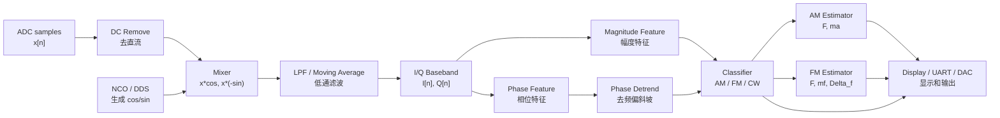

# 2023D 第十二课：从 Python 流程翻译到 FPGA 模块图

前面几课是在 Python 里验证算法。现在开始做一件更接近 FPGA 的事：

```text
把算法拆成硬件模块。
```

这一课不写 Verilog，先看结构。

## 1. Python 里的完整流程

第十一课的流程是：

```text
ADC 输入 x[n]
    ↓
去直流
    ↓
DDC/IQ
    ↓
低通/移动平均
    ↓
magnitude 和 phase
    ↓
AM/FM/CW 分类
    ↓
AM 参数估计 或 FM 参数估计
```

在 FPGA 里，每一步都要变成一个模块。

## 2. FPGA 模块图



## 3. 每个模块做什么

### ADC 接收模块

作用：

```text
从 ADDA 模块拿到 8 bit 采样值。
```

它只关心一件事：

```text
每个采样时钟来一个 x[n]。
```

### 去直流模块

Python 里写的是：

```python
x = x - np.mean(x[start:stop])
```

FPGA 里可以做成：

```text
一段时间内累加采样值
求平均
后续采样减掉这个平均值
```

目的：

```text
不要让 ADC 偏置、电路偏置污染 DDC。
```

### NCO / DDS 模块

作用：

```text
生成本地 2 MHz 的 cos 和 sin。
```

Python 里是：

```python
cos(2*pi*FC*t)
sin(2*pi*FC*t)
```

FPGA 里不会每次算三角函数，而是：

```text
相位累加器 + 查表 ROM
```

这就是 DDS。

### Mixer 混频模块

Python 里是：

```python
i = x * cos
q = x * (-sin)
```

FPGA 里就是两个乘法器：

```text
I_raw[n] = x[n] * cos[n]
Q_raw[n] = x[n] * -sin[n]
```

这一步把 2 MHz 附近的信号搬到低频。

### 低通滤波模块

混频后会同时出现：

```text
基带低频分量
约 4 MHz 的高频分量
```

所以要低通。

教学阶段可以先用移动平均：

```text
I[n] = average(I_raw 最近 N 点)
Q[n] = average(Q_raw 最近 N 点)
```

以后需要更好效果，再换 FIR。

### magnitude 模块

Python 里是：

```python
magnitude = sqrt(I*I + Q*Q)
```

FPGA 初期可以先不用开方：

```text
mag2 = I*I + Q*Q
```

因为判断 AM 时，很多时候只需要知道它有没有明显变化。

### phase 模块

Python 里是：

```python
phase = atan2(Q, I)
```

FPGA 里常见做法：

```text
CORDIC
```

CORDIC 可以从 I/Q 算：

```text
幅度
相位
```

但它比前面几个模块难，所以我们不会第一天就写它。

### phase detrend 模块

作用：

```text
估计 phase 的线性斜坡
减掉斜坡
```

教学版可以先近似：

```text
slope ≈ (phase_end - phase_start) / 时间长度
```

这对应 Python 里的：

```python
np.polyfit(t, phase, 1)
```

只是 FPGA 上用更简单的近似。

### 分类器模块

分类器不做复杂数学，它只看特征：

```text
如果 magnitude 变化大 -> AM
否则如果 phase_detrended 变化大 -> FM
否则 -> CW
```

这就是第七课、第八课、第十一课的逻辑。

### 参数估计模块

AM 分支：

```text
用 magnitude 估 F 和 ma
```

FM 分支：

```text
用 phase_detrended 估 F 和 mf
Delta_f_max = mf * F
```

F 的候选只有：

```text
1 kHz, 2 kHz, 3 kHz, 4 kHz, 5 kHz
```

所以可以用相关法或 Goertzel：

```text
分别给 5 个候选频率打分
分数最大的是估计结果
```

## 4. 先实现哪几个模块

真正写 Verilog 时，不建议一口气写完整系统。

更稳的顺序是：

```text
1. DDS/NCO：先能生成 2 MHz cos/sin
2. Mixer：能把输入乘 cos/sin
3. Moving Average：能做简单低通
4. I/Q 仿真：确认基带结果像 Python
5. magnitude AM 判断
6. phase / CORDIC
7. FM/CW 判断
8. 参数估计和显示
```

也就是说，第一块硬骨头不是“整题”，而是：

```text
DDS + Mixer + LPF
```

## 5. Python 和 FPGA 的对应表

| Python 写法 | FPGA 模块 |
| --- | --- |
| `np.arange(...) / FS` | 采样时钟计数 |
| `cos(2*pi*FC*t)` | DDS/NCO 查表 |
| `x * cos` | 乘法器 / DSP Slice |
| `moving_average(...)` | 累加器 + 延迟线 |
| `sqrt(I*I + Q*Q)` | CORDIC 或近似幅度 |
| `atan2(Q, I)` | CORDIC |
| `np.polyfit(...)` | 斜率近似或累加拟合 |
| `sum(feature * sin/cos)` | 相关器 / Goertzel |
| `if threshold...` | 比较器 + 状态机 |

## 6. 这一课要记住

```text
FPGA 不是把 Python 一行一行翻译成 Verilog。
FPGA 是把 Python 里的运算流程拆成会并行工作的硬件模块。
```

Python 更像：

```text
先做完 A，再做 B，再做 C
```

FPGA 更像：

```text
每个时钟来一个采样点，
所有模块同时往前推一步。
```

这就是后面学习 Verilog 时最重要的视角变化。

## 7. 小变形检查题

### 题 1

Python 里的：

```python
np.cos(2*np.pi*FC*t)
```

在 FPGA 里更可能用什么模块实现？

### 题 2

为什么 DDC 后要接低通滤波？

### 题 3

为什么 FPGA 不是“照着 Python 一行行翻译”？
