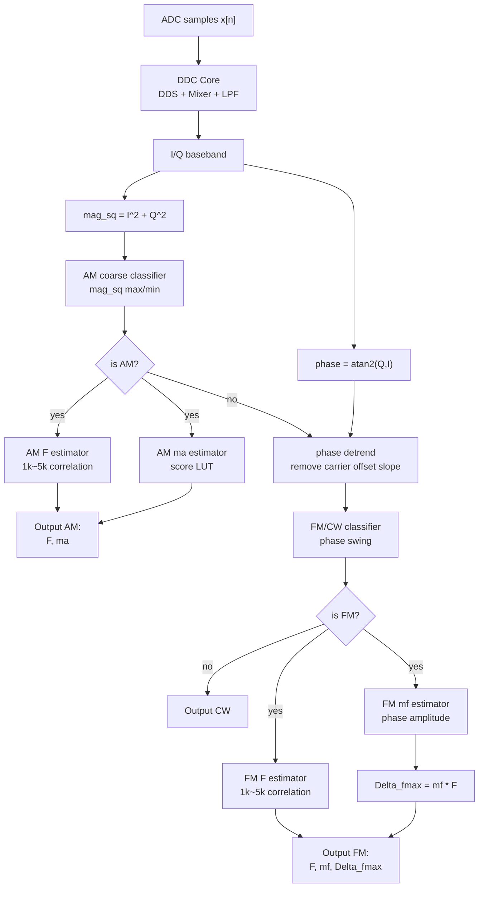
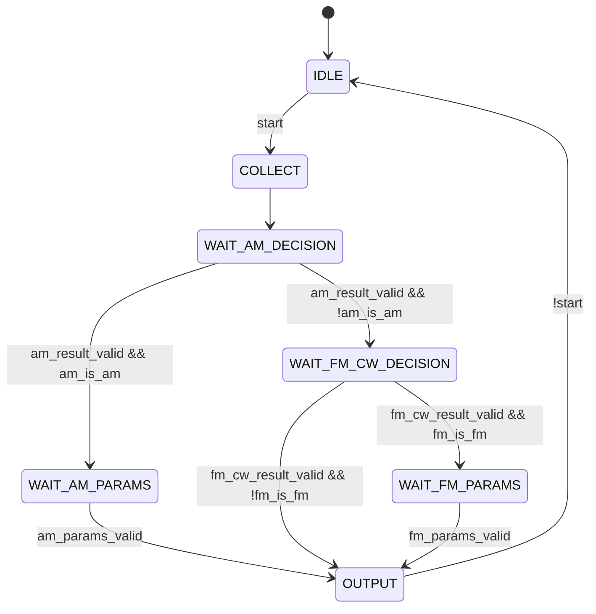

# 2023D 第二十六课：总体流程图和状态机

前面 25 课已经有了很多积木：

```text
DDC Core
mag_sq 幅度特征
AM 粗分类
AM ma 估计
AM F 估计
phase 相位特征
phase detrend
FM/CW 分类
FM F/mf/Delta_fmax 估计
```

这一课不新增数学，而是把它们整理成顶层流程。

## 1. 总体识别流程



## 2. 为什么先判 AM

AM 的特征最明显在幅度：

```text
AM -> mag_sq 明显起伏
FM/CW -> mag_sq 理想上较稳定
```

所以顶层先问：

```text
是不是 AM？
```

如果是 AM，就不必再走 FM/CW 分支。

如果不是 AM，再看 phase：

```text
phase_detrended 摆动明显 -> FM
phase_detrended 几乎平 -> CW
```

这叫分层分类。

## 3. 状态机视角

算法流程可以写成状态机：



每个状态做的事：

| 状态 | 作用 |
| --- | --- |
| `IDLE` | 等待开始 |
| `COLLECT` | 打开采样/特征统计 |
| `WAIT_AM_DECISION` | 等 AM 粗分类结果 |
| `WAIT_AM_PARAMS` | 等 AM 的 `F` 和 `ma` |
| `WAIT_FM_CW_DECISION` | 等 FM/CW 分类结果 |
| `WAIT_FM_PARAMS` | 等 FM 的 `F`、`mf`、`Delta_fmax` |
| `OUTPUT` | 输出识别结果 |

## 4. 教学版 FSM RTL

文件：

```text
rtl/recognition_fsm_skeleton.v
```

它不是完整顶层，只是教学版状态机骨架。

它假设前面的模块会给出：

```text
am_result_valid
am_is_am
am_params_valid
fm_cw_result_valid
fm_is_fm
fm_params_valid
```

状态机负责：

```text
等结果
选择分支
锁存最终输出
```

输出类型：

```text
KIND_CW = 0
KIND_AM = 1
KIND_FM = 2
```

## 5. 为什么不是所有模块都同时输出

FPGA 里很多模块是流式工作的，但参数估计通常要观察一个窗口：

```text
BLOCK_LEN 个有效样本
```

所以结果不会每拍都有。

典型形式是：

```text
输入 valid_in 连续来
模块内部统计一个 block
block 结束时 result_valid 拉高一拍
输出本 block 的结果
```

状态机就是根据这些 `result_valid` 决定下一步。

## 6. 现在这个顶层还缺什么

当前我们已经写了不少 RTL 积木，但还不是完整可上板系统。

主要缺：

```text
ADC 接口
CORDIC atan2
phase unwrap / detrend 的硬件实现
5 个候选频率 scorer 的组合顶层
显示/UART 输出
约束文件 XDC
真实板卡时钟和引脚
```

所以第 26 课不是说“题目已经完成”，而是说：

```text
识别算法的顶层结构已经清楚了。
```

下一阶段才是把缺的硬件模块补上。

## 7. 这一课要记住

```text
顶层不是再写一个巨大公式。
顶层是在调度各个已经验证过的模块。
```

最核心的决策树是：

```text
mag_sq 起伏大 -> AM
否则 phase_detrended 摆动大 -> FM
否则 -> CW
```

## 8. 小变形检查题

### 题 1

为什么顶层流程先判断 AM，而不是先判断 FM？

### 题 2

`result_valid` 在状态机里起什么作用？

### 题 3

为什么现在的 `recognition_fsm_skeleton.v` 只是骨架，还不是完整顶层？
