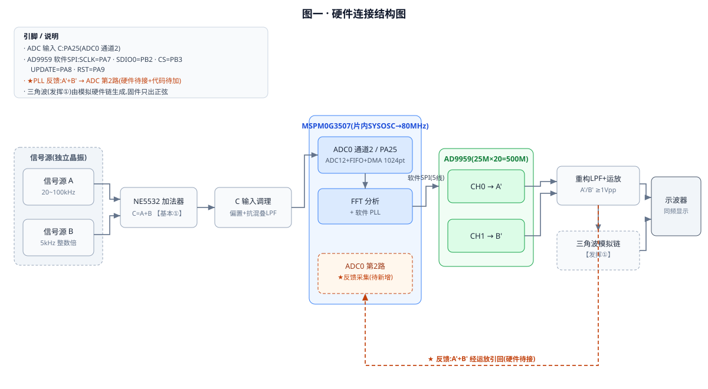
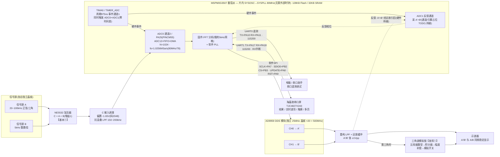
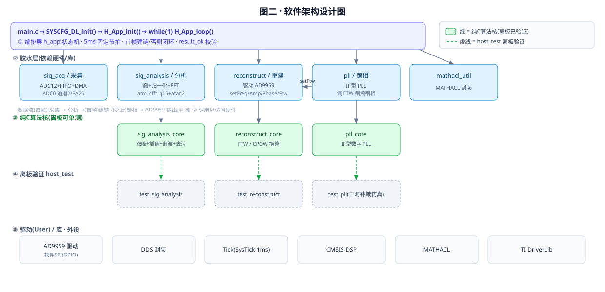
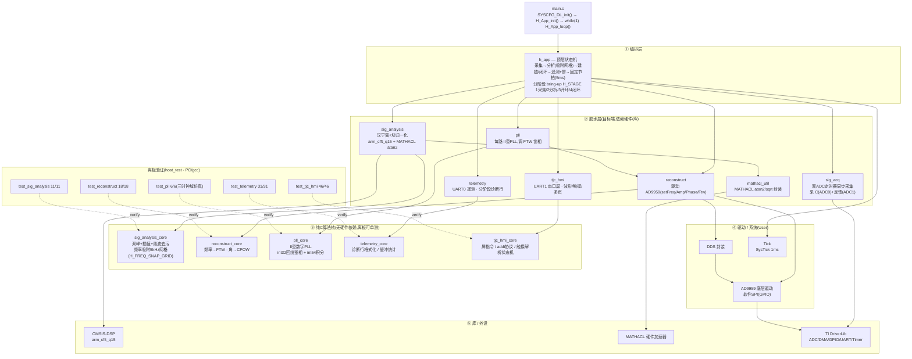

# 2023 H题 信号分离装置 — 系统框图(番茄派 MSPM0G3507 + AD9959)

> 两张图:**硬件连接结构图** + **软件架构设计图**。均按当前仓库真实代码绘制
> (引脚来自 `代码/H_SignalSep.syscfg`、`代码/app/sig_acq.c`、`代码/User/AD9959.h`;
> 模块来自 `代码/app`、`代码/User`)。GitHub 原生渲染 Mermaid,直接看即可。

---

## 一、硬件连接结构图

静态 SVG(报告可直接插);下方为 Mermaid 源(可编辑)。

要点 / 注意(对应 `上板联调清单.md`):
- **双 ADC 同步**:`TIMA0`(TIMER_ADC)周期事件经事件通道 1 **同时触发 ADC0/ADC1**,两路零时间差(发挥②相位差 ≤5° 的关键);`fs = 80MHz/78 = 1.0256MSa/s` 稳定无抖,无需标定。
- **频率吸附**:测得频率吸附到 5kHz 网格(`H_FREQ_SNAP_GRID`),中和片内 SYSOSC ±2% 的 fs 绝对误差,AD9959 输出精确网格频率、PLL 只拉两晶振 ppm 级差。
- **串口遥测(UART0)**:经 PA10/PA11(115200)向电脑打印诊断行,配合**分阶段 bring-up**(`H_STAGE` 1采集/2分析/3开环/4闭环)逐级排错,取代挂 JTAG 翻内存。
- **串口屏(UART1)**:经 PA17/PA18(115200,RX 中断)驱动淘晶驰屏 —— 结果页 + 实时波形页(`addt` 透传)+ 触摸调相位 + 多页;**波形需波特率 115200 三方一致**(屏工程/syscfg/固件)。
- **PLL 反馈通道**是头号待办(清单 必修1):代码已就绪,差的是把 A′+B′ 经运放引回 ADC1 + ADC1 通道/引脚占位确认(`H_FB_CHAN`/`H_FB_PIN_IOMUX` 标 TODO)。不接它"同频稳定显示"做不出来。
- 上电顺序:AD9959 先于单片机上电;确认其晶振 25MHz、PLL=500MHz(否则改 `ACC_FRE_FACTOR`/`PLL_DDS_REF_HZ`,清单 必修3)。
- ADC 输入引脚 PA25 需对照番茄派丝印确认(清单 必修2)。
- 三角波(发挥①)由模拟硬件生成,固件只出正弦。

---

## 二、软件架构设计图

静态 SVG(报告可直接插);下方为 Mermaid 源(可编辑)。

数据流(`H_App_loop` 一轮):
1. `sig_acq` 双路**定时器同步**采 1024 点:C(ADC0)+ 反馈 A′+B′(ADC1),同一事件触发零时间差,每轮先冲 FIFO 残留。
2. `sig_analysis` 对 C 加窗+归一化+FFT → `sig_analysis_core` 出两路 频率/幅度/波形/峰bin,**频率吸附到 5kHz 网格(H_FREQ_SNAP_GRID)**,再 MATHACL 算相位。
3. 首帧:两路都 `result_ok` 才 `Reconstruct_set`(建 A′/B′)+ `Pll_retune`(预调谐 FTW)。
4. 之后:`H_App_measureFeedback` 对反馈缓冲在已知 bin 处提取相位 → 每路 `Pll_track` 调 FTW 锁频锁相;触摸设定的相位差目标写入 `s_target`。
5. 每轮(按抽稀)经 `telemetry`(UART0)打印诊断行、经 `tjc_hmi`(UART1)推送结果 / 波形页 addt 透流。
6. 固定 5ms 节拍(回绕安全),处理超时则立即继续。

分层设计意图:
- 纯C核(`*_core`)无任何硬件/库依赖 → 在 PC 上用 gcc 离板单测(host_test 已 **11/11(sig_analysis)+ 6/6(pll)+ 18/18(reconstruct)+ 31/31(telemetry)+ 46/46(tjc_hmi)** 全过),把算法对错与硬件解耦。
- 胶水层只负责把核接到 CMSIS-DSP / MATHACL / AD9959 / UART(遥测·屏)等具体硬件。
- 移植到别的平台时,纯C核几乎不动,只改 胶水层/驱动/库。

---
*配套:`代码/`(工程)、`上板联调清单.md`(上板步骤+症状排查)、`README.md`。*
