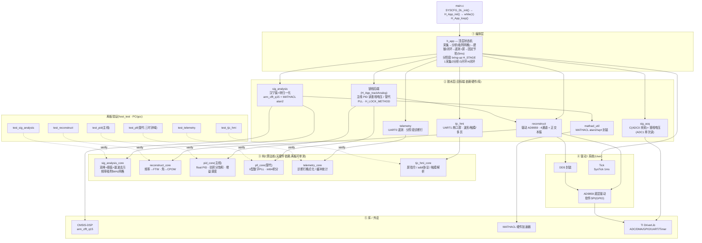

# 2023 H题 信号分离装置 — 系统框图(番茄派 MSPM0G3507 + AD9959)

> 两张图:**硬件连接结构图** + **软件架构设计图**。**主线为「模拟鉴相 + PID」**(两张 SVG 与下方 Mermaid 均已按主线绘制),数字 PLL 为可一键切回的替代。
> (引脚来自 `代码/H_SignalSep.syscfg`、`代码/app/sig_acq.c`、`代码/User/AD9959.h`;模块来自 `代码/app`、`代码/User`)。GitHub 原生渲染 Mermaid,直接看即可。

---

## 一、硬件连接结构图

```mermaid
flowchart LR
  subgraph SRC["信号源(各自独立晶振)"]
    A["信号源 A<br/>20~100kHz 正弦/三角"]
    B["信号源 B<br/>5kHz 整数倍"]
  end

  ADD["NE5532 加法器<br/>C = A + B(增益1)<br/>【基本①】"]
  COND["C 输入调理<br/>偏置~1.65V · 抗混叠 LPF"]
  A --> ADD
  B --> ADD
  ADD --> COND

  subgraph MCU["MSPM0G3507 番茄派 — 片内 SYSOSC→80MHz · 128KB/32KB"]
    TRIG["TIMA0 / TIMER_ADC<br/>触发 ADC0 · 锁 fs"]
    ADC0["ADC0 通道2 / PA25<br/>ADC12+FIFO+DMA · N=1024"]
    FW["固件:FFT 测频(粗)<br/>+ PID 闭环(主线)"]
    ADC1["ADC1:读 2 路鉴相电压<br/>PD_A/PD_B(H_PD_* TODO)"]
    TRIG -->|硬件事件| ADC0
    ADC0 --> FW
    ADC1 -->|"鉴相电压"| FW
  end
  COND --> ADC0

  subgraph DDSCHIP["AD9959 DDS(独立 25MHz×20 = 500MHz)"]
    CH0["CH0 → A'"]
    CH1["CH1 → B'"]
    CH2["CH2 → 正交本振 LO_A 90°"]
    CH3["CH3 → 正交本振 LO_B 90°"]
  end
  FW -->|"软件SPI<br/>SCLK=PA7·SDIO0=PB2·CS=PB3·UPDATE=PA8·RST=PA9"| DDSCHIP

  subgraph PDFE["模拟鉴相前端(主线核心)"]
    MULA["乘法器 A<br/>C × LO_A"]
    LPFA["低通 LPF<br/>去 2ω / 拍频"]
    BIASA["抬偏置 1.65V<br/>正交零点 → PD_A"]
    MULA --> LPFA --> BIASA
    MULB["乘法器 B(同构)<br/>C × LO_B → LPF → 偏置 → PD_B"]
  end
  COND -->|"C 馈鉴相"| MULA
  COND -->|"C"| MULB
  CH2 -->|"LO_A"| MULA
  CH3 -->|"LO_B"| MULB
  BIASA -->|"PD_A"| ADC1
  MULB -->|"PD_B"| ADC1

  OUT["重构 LPF + 运放缓冲<br/>A'/B' 各 ≥1Vpp"]
  CH0 --> OUT
  CH1 --> OUT
  TRI["三角波模拟链【发挥①】<br/>比较器→积分器→幅度补偿"]
  OUT -->|"需三角时"| TRI
  SCOPE["示波器<br/>A'/B' 与 A/B 同频稳定显示"]
  OUT --> SCOPE
  TRI --> SCOPE

  PC["电脑 / 串口助手<br/>串口遥测调试"]
  FW -->|"UART0 遥测<br/>TX=PA10 RX=PA11 · 115200"| PC
  HMI["淘晶驰串口屏 TJC4827X243<br/>结果 / 实时波形 / 触摸 / 多页"]
  FW <-->|"UART1 TX=PA17 RX=PA18<br/>115200 · RX中断"| HMI
```

静态 SVG(报告可直接插);下方为 Mermaid 源(可编辑)。

要点 / 注意(对应 `上板联调清单.md`):
- **主线锁相 = 模拟鉴相 + PID**:外部模拟乘法器把 `C × AD9959 正交本振(CH2/CH3,90°)` 出鉴相直流电压,经 LPF 去 2ω/拍频、抬偏置到 1.65V(正交零点)后进 ADC1(PD_A/PD_B);固件 `H_App_trackAnalog` 读电压 → 每路 PID 微调 DDS 频率把相位拉到正交锁定。AD9959 用 4 通道(CH0/1 输出 A'/B' + CH2/3 正交本振)。
- **接好鉴相硬件**是头号待办(清单 必修1):乘法器 + 两路 LPF + 偏置基准 + 两路 PD 电压进 ADC1(`H_PD_CHAN_*` / `H_PD_PIN_*_IOMUX` 占位 TODO,上板确认引脚)。两个离板看不见的坑:**环路符号**(反了会发散,留"增益符号一键翻转")、**LPF 带宽 vs 拍频 fB−fA**(两频靠近时差频漏过低通污染直流)。
- **采样**:`TIMA0` 触发 ADC0 锁 `fs = 80MHz/78 = 1.0256MSa/s` 稳定无抖;主线模拟下 ADC1 单次读两路鉴相电压(不与 ADC0 块同步);数字替代才需双 ADC 零时间差同触(发挥②)。
- **频率吸附**:测得频率吸附到 5kHz 网格(`H_FREQ_SNAP_GRID`),中和片内 SYSOSC ±2% 的 fs 绝对误差,本振一上来就落在捕获带内,模拟环只做细相位锁。
- **串口遥测(UART0)**:PA10/PA11(115200)向电脑打印诊断行(含鉴相电压 / PID 输出 / 锁定),配合**分阶段 bring-up**(`H_STAGE` 1采集 / 2分析 / 3开环 / 4闭环)逐级排错,取代挂 JTAG 翻内存。
- **串口屏(UART1)**:PA17/PA18(115200,RX 中断)驱动淘晶驰屏 —— 结果页 + 波形页(`addt` 透传)+ 触摸调相位 + 多页;**波特率三方一致**(屏工程 / syscfg / 固件)。
- **替代:全数字 PLL**(`H_LOCK_METHOD = H_LOCK_DIGITAL_PLL`):A′+B′ 经运放引回 ADC1 → 块采 + FFT + atan2 提相位 → II 型 PLL 调 FTW(`H_FB_*` TODO)。
- 上电顺序:AD9959 先于单片机上电;确认其晶振 25MHz、PLL=500MHz(否则改 `ACC_FRE_FACTOR` / `PLL_DDS_REF_HZ`,清单 必修3)。ADC 输入引脚 PA25 对照番茄派丝印确认(清单 必修2)。三角波(发挥①)由模拟硬件生成,固件只出正弦。

---

## 二、软件架构设计图

静态 SVG(报告可直接插);下方为 Mermaid 源(可编辑)。

数据流(`H_App_loop` 一轮,主线模拟):
1. `sig_acq` 采 1024 点 C(ADC0 块采);`SigAcq_readPD` 单次读两路鉴相电压 PD_A/PD_B(模拟乘法器输出)。
2. `sig_analysis` 对 C 加窗+归一化+FFT → `sig_analysis_core` 出两路 频率/幅度/波形/峰bin,**频率吸附到 5kHz 网格**,MATHACL 算相位。
3. 首帧:两路都 `result_ok` 才建链 —— `Reconstruct_setAnalog` 驱动 AD9959 四通道(CH0/1 输出 + CH2/3 正交本振 90°)起振,`PidCore_init`。
4. 之后:`H_App_trackAnalog` —— 读鉴相电压(去 1.65V 偏置)→ 每路 `PidCore_update`(增益按频率调度)→ 微调 DDS 频率把相位拉到正交锁定;触摸设定的相位差经正交本振相位偏移实现。
5. 每轮(按抽稀)经 `telemetry`(UART0)打印诊断行、经 `tjc_hmi`(UART1)推送结果 / 波形页 addt 透流。
6. 固定 5ms 节拍(回绕安全),处理超时则立即继续。

*(替代:全数字 PLL 时改为 `SigAcq_captureDual` 块采 A′+B′ → `H_App_measureFeedback` 在已知 bin 处 FFT 提相位 → `Pll_track` 调 FTW。)*

分层设计意图:
- 纯C核(`*_core`)无任何硬件/库依赖 → 在 PC 上用 gcc 离板单测(host_test 六套:sig_analysis / reconstruct / **pid(主线)** / pll(替代) / telemetry / tjc_hmi 全过),把算法对错与硬件解耦。
- 胶水层只负责把核接到 CMSIS-DSP / MATHACL / AD9959 / UART(遥测·屏)等具体硬件;锁相后端(`H_App_trackAnalog`)按 `H_LOCK_METHOD` 在主线 `pid_core` 与替代 `pll_core` 间切换。
- 移植到别的平台时,纯C核几乎不动,只改 胶水层/驱动/库。

---
*配套:`代码/`(工程)、`上板联调清单.md`(上板步骤+症状排查)、`README.md`。*
