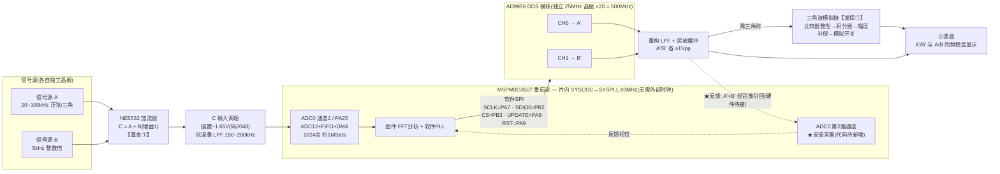
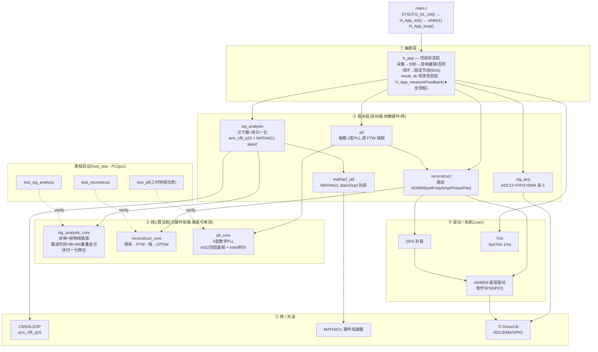

# 2023 H题 信号分离装置 — 系统框图(番茄派 MSPM0G3507 + AD9959)

> 两张图:**硬件连接结构图** + **软件架构设计图**。均按当前仓库真实代码绘制
> (引脚来自 `代码/H_SignalSep.syscfg`、`代码/app/sig_acq.c`、`代码/User/AD9959.h`;
> 模块来自 `代码/app`、`代码/User`)。GitHub 原生渲染 Mermaid,直接看即可。

---

## 一、硬件连接结构图

静态 SVG(报告可直接插);下方为 Mermaid 源(可编辑)。

**要点 / 注意(对应 `上板联调清单.md`):**
- **★ PLL 反馈通道是头号待办**(清单 🔴-1):A′+B′ 须经运放引回 **ADC 第 2 路**,且代码里第 2 路 ADC 采集尚未实现(`H_App_measureFeedback` 现为占位桩)。不接它「同频稳定显示」做不出来。
- **上电顺序**:AD9959 先于单片机上电;确认其晶振 25MHz、PLL=500MHz(否则改 `ACC_FRE_FACTOR`/`PLL_DDS_REF_HZ`,清单 🔴-3)。
- **ADC 引脚 PA25** 需对照番茄派丝印确认(清单 🔴-2);**fs 需上板标定**(清单 🔴-4)。
- 三角波(发挥①)由**模拟硬件**生成,固件只出正弦。

---

## 二、软件架构设计图

静态 SVG(报告可直接插);下方为 Mermaid 源(可编辑)。

**数据流(`H_App_loop` 一轮):**
1. `sig_acq` 采 1024 点混合信号 C(每轮先冲 FIFO 残留)。
2. `sig_analysis` 加窗+归一化+FFT → `sig_analysis_core` 出两路 频率/幅度/波形/峰bin,再 MATHACL 算相位。
3. **首帧**:两路都 `result_ok` 才 `Reconstruct_set`(建 A′/B′)+ `Pll_retune`(预调谐 FTW)。
4. **之后**:`H_App_measureFeedback`(★桩,待接第2路ADC)→ 每路 `Pll_track` 调 FTW 锁频锁相。
5. 固定 5ms 节拍(回绕安全),处理超时则立即继续。

**分层设计意图:**
- **③ 纯C核**(`*_core`)无任何硬件/库依赖 → 在 PC 上用 gcc **离板单测**(host_test 已 9/9 + 6/6 + 18/18 全过),把算法对错与硬件解耦。
- **② 胶水层** 只负责把核接到 CMSIS-DSP / MATHACL / AD9959 等具体硬件。
- 移植到别的平台时,**③ 几乎不动,只改 ②/④/⑤**。

---
*配套:`代码/`(工程)、`上板联调清单.md`(上板步骤+症状排查)、`导读.md`、`README.md`。*
