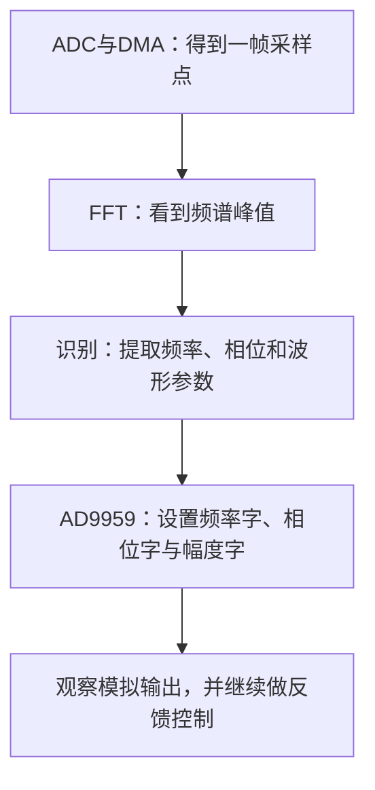

# 第一次打开这份仓库

先选一个能在调试器里看清结果的小实验，再把它接到完整题目。这里以采样例程为起点，说明源码在哪里、怎样导入，以及做完一段后应该看什么。

## 先取到源码

```bash
git clone https://github.com/liusuan110/2026-Ti.git
cd 2026-Ti
```

也可在 GitHub 选择 Code → Download ZIP 后解压。下文的路径都从仓库根目录开始。

这条学习路线最终连接的是采样、理解和输出：



前两步从 ADC / FFT 例程进入；识别与参数传递到 H题中继续阅读，DDS 从培训工程进入。每份工程先独立运行，再比较接口与配置。

## 选一个具体的观察目标

| 今天想看什么 | 打开哪个目录 | 第一处观察点 |
| --- | --- | --- |
| 定时器怎样决定采样时刻 | [15_adc_dma_time_trigger](../MSPM0例程-双ADC同步采样与FFT/15_adc_dma_time_trigger/README.md) | 定时事件、ADC 触发源与样本缓冲区 |
| 两路数据怎样存到内存 | [14_adc_dma_2ch](../MSPM0例程-双ADC同步采样与FFT/14_adc_dma_2ch/README.md) | 两个不同输入在 `gADCSamples` 中的排列 |
| 一帧信号怎样变成频谱 | [12_FFT](../MSPM0例程-双ADC同步采样与FFT/12_FFT/README.md) | 原始数组、FFT 输入和模值结果 |
| 频率、相位和幅度怎样变成输出 | [番茄派 AD9959 培训工程](../AD9959-DDS信号源资料/番茄派例程-MSPM0G3507_AD9959-学长培训/_导读-本地说明.md) | 示波器上的点频、相位差与扫描 |

## CCS 中的两种入口

三个 ADC 例程已经有 `.project/.cproject/.ccsproject`。在 CCS 中选择 **Import CCS Projects**，把搜索目录定位到所选子目录，例如：

```text
MSPM0例程-双ADC同步采样与FFT/
└── 12_FFT/                 ← 搜索这一层
    ├── .project
    ├── .cproject
    ├── .ccsproject
    ├── empty.syscfg        ← 时钟、引脚与外设
    ├── empty.c             ← 主程序
    └── Hardware/adc.c      ← 采集、DMA与分析
```

导入后项目名分别是 `12_FFT`、`14_adc_dma_2ch` 和 `15_adc_dma_time_trigger`。先打开 `empty.syscfg`，再读 `empty.c` 和 `Hardware/adc.c`。

H_SignalSep 使用 [.projectspec 描述文件](../2023-H题-信号分离-番茄派工程/代码/H_SignalSep.projectspec)。导入时定位到 `2023-H题-信号分离-番茄派工程/代码/`，由该文件生成工程；模块和环境说明见[代码 README](../2023-H题-信号分离-番茄派工程/代码/README.md)。

## 先认清例程保存的是哪套板级配置

三个 ADC 例程保存的环境是 TI Arm Clang 3.2.2 LTS、MSPM0 SDK 2.01.00.03，板级配置为 LQFP-64(PM) 与 24 MHz HFXT。它们的配置和后续番茄派、H题工程属于不同的开发阶段。

在自己的板上复用时，按“器件与封装 → 时钟 → 引脚 → 触发与 DMA”的顺序打开 SysConfig。采样节拍变化后，FFT 的频率换算也跟着更新。工具版本及 SysConfig 生成记录集中列在[采样例程总览](../MSPM0例程-双ADC同步采样与FFT/README.md#工程环境)。

第一次实验先观察内存数组：采样点有没有随输入变化、DMA 是否完成、FFT 峰值是否随频率移动。OLED 和串口演示可以在数据链路看清后再接着研究；各子目录导读列出了当前程序实际更新的变量。

## 接到 H题时，读参数怎样流动

[采集模块 sig_acq.c](../2023-H题-信号分离-番茄派工程/代码/app/sig_acq.c) 负责取一帧数据，[分析模块 sig_analysis.c](../2023-H题-信号分离-番茄派工程/代码/app/sig_analysis.c) 提取信号信息，[重建模块 reconstruct.c](../2023-H题-信号分离-番茄派工程/代码/app/reconstruct.c) 把结果转成输出控制。

DDS 根据寄存器参数生成连续信号。因此，从 FFT 到 AD9959 要交接的是频率、相位、幅度和波形判断；读到这一步，再回头看采样率、频率分辨率与锁相，它们就有了具体的用途。

接下来沿[资产索引](ASSET_INDEX.md)选择完整题目，或到 [ti-last](https://github.com/liusuan110/ti-last) 看这套控制思路在 F题中的应用。
